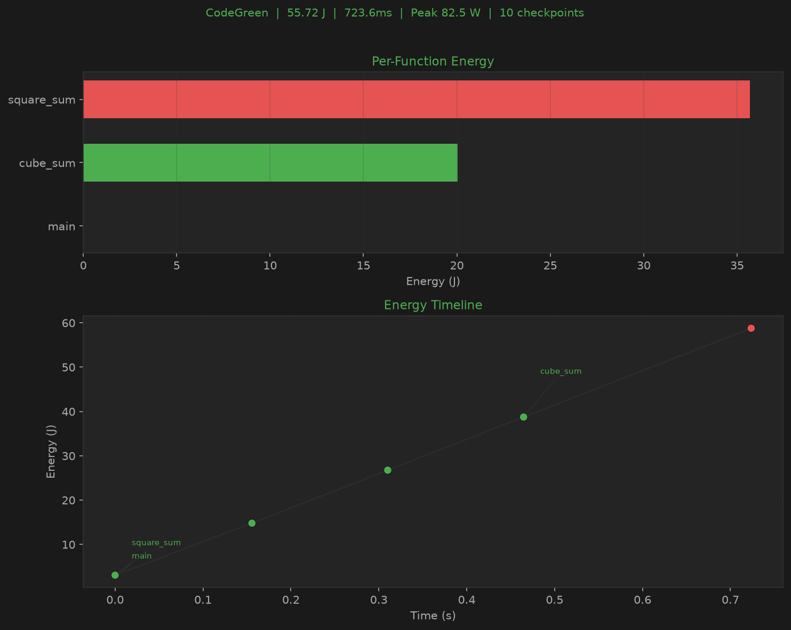

# Reports and Visualization

## Output formats

| Command | Terminal | `--json` | File |
|---|---|---|---|
| `measure` | energy, time, power, per-function table, validity | full report on stdout | `-o FILE` writes the `--json` report |
| `run` | mean, spread, CI, domains, validity | full report on stdout | redirect stdout |
| `project` | per-run energy, hotspot table, validity | full report on stdout | `-o DIR` writes `DIR/project_results.json` |
| `monitor` | live samples and a summary | summary on stdout | `-o FILE` streams JSON lines |
| `Session` (Python) | | | `codegreen_<pid>.json` by default, or CSV |

In every report, energies are in joules (`_j`), times in seconds (`_s`) or
nanoseconds (`_ns`) and power in watts (`_w`). The `validity` block and its
codes are described in
[Exit codes and measurement validity](cli-reference.md#exit-codes-and-measurement-validity).

## The `measure` JSON report

`codegreen measure python sums.py -g fine --sensors rapl --json`, with the
instrumentation points and most checkpoints and sampler fields removed (the
program is in the [Quick Start](../getting-started/quickstart.md)):

```json
{
  "success": true,
  "file": "sums.py",
  "language": "python",
  "granularity": "fine",
  "source_fingerprint": "...",
  "system": {"kernel": "5.15.0-139-generic", "cpu_model": "AMD EPYC 9554P 64-Core Processor", "governor": "performance"},
  "summary": {
    "total_energy_j": 58.689323256708356,
    "wall_time_s": 0.759985133,
    "avg_power_w": 77.22430440847631,
    "checkpoint_count": 10,
    "energy_by_provider": {"intel_rapl": 58.689323},
    "providers": ["intel_rapl"],
    "sensors_requested": ["rapl"],
    "exclusive_sum_j": 58.689323,
    "exclusive_sum_ratio": 1.0,
    "overlapping_threads": 1
  },
  "instrumentation_points": {},
  "per_function_energy": {
    "main":       {"energy_j": 58.689323, "inclusive_j": 58.689323, "exclusive_j": 0.002751,
                   "wall_time_s": 0.759985133, "avg_power_w": 77.22, "calls": 1, "quality": "measured"},
    "square_sum": {"energy_j": 37.483515, "inclusive_j": 37.483515, "exclusive_j": 37.483515,
                   "wall_time_s": 0.485782177, "avg_power_w": 77.16, "calls": 3, "quality": "measured"},
    "cube_sum":   {"energy_j": 21.203057, "inclusive_j": 21.203057, "exclusive_j": 21.203057,
                   "wall_time_s": 0.274162696, "avg_power_w": 77.34, "calls": 1, "quality": "measured"}
  },
  "checkpoints": [
    {"checkpoint_id": "enter:main:function_enter_main_8_1#inv_1_t15540708132652139232",
     "timestamp": 37132208765435856, "joules": 2.526685902262177, "watts": 0.12192525190311514,
     "ri": 2, "clamp": "none", "provider_j": {"intel_rapl": 2.526685902262177}}
  ],
  "sampler": {"interval_ms": 10, "buffer_capacity": 100000, "marker_reads": "interpolated", "providers": []},
  "validity": {"status": "valid", "reasons": [], "detail": {}, "warnings": {}},
  "optimization_suggestions": [],
  "instrumentation_audit": {"prospects_detected": 6, "fine_runtime_checkpoints": 10, "fallback_to_coarse": false}
}
```

| Field | Meaning |
|---|---|
| `summary.total_energy_j`, `wall_time_s`, `avg_power_w` | Energy, time and power of the root window (first to last checkpoint), not of the whole process |
| `summary.energy_by_provider`, `providers`, `sensors_requested` | The root window's energy per NEMB provider, the providers read, and the `--sensors` selection |
| `summary.exclusive_sum_j`, `exclusive_sum_ratio` | Sum of the exclusive energies and its ratio to the total: 1.0 when the root function encloses every other, above 1.0 when threads overlap |
| `summary.overlapping_threads` | Most threads inside instrumented functions at the same time |
| `per_function_energy.<f>.inclusive_j` | Energy from entry to exit, callees included, summed over every call. A recursive function counts each nested frame, so its value can exceed the total |
| `per_function_energy.<f>.exclusive_j` | Energy of the function's own body: inclusive energy minus that of its instrumented callees. Exclusive energies partition the run |
| `per_function_energy.<f>.energy_j` | Same as `inclusive_j` |
| `per_function_energy.<f>.wall_time_s`, `calls`, `avg_power_w` | Time summed over calls, call count, `inclusive_j / wall_time_s` |
| `per_function_energy.<f>.quality` | `measured`, `aggregate_only` or `below_resolution` ([Per-function quality](cli-reference.md#per-function-quality)) |
| `checkpoints[]` | The NEMB markers; see [Auto-instrumenter output format](../api/python.md#auto-instrumenter-output-format) |
| `sampler`, `validity` | Sampler statistics and the verdict ([field list](cli-reference.md#exit-codes-and-measurement-validity)) |
| `instrumentation_audit` | Instrumentation points found, checkpoints recorded, and whether a fine run fell back to coarse |

Without `--json`, the per-function table prints `Excl J`, `Incl J`, `Calls`
and `Quality`, sorted by exclusive energy.

## The `run` and `project` reports

`run --json` reports `energy_j`, `duration_s` and `power_w` statistics
(`mean`, `std`, `min`, `max`, and for energy and power `ci95_lower`,
`ci95_upper`; energy also `cv_percent_across_runs`), per-run readings in
`runs`, per-domain means and the validity verdict; see
[CLI Reference: `run`](cli-reference.md#run). The `project` report is
described in [Project Profiling](project-profiling.md#output). The two
per-function schemas name exclusive energy differently: `project` uses
`exclusive_energy_j`, `measure` uses `exclusive_j`.

## Energy timeline plot

`--export-plot PATH` on `measure` renders the checkpoints. The format follows
the extension: `.html` (Plotly, interactive) or `.png` / `.pdf` (matplotlib);
any other extension, or none, writes HTML to the path with its extension
replaced by `.html`.

```bash
codegreen measure python sums.py -g fine --sensors rapl --export-plot energy.html
codegreen measure python sums.py -g fine --sensors rapl --export-plot energy.png
```



*The PNG written by the second command (AMD EPYC 9554P).*

- **Per-function bars.** For each function, the energy of the intervals that
  end at its exit checkpoints. This approximates exclusive energy; the exact
  inclusive and exclusive figures are in `per_function_energy`. Functions at
  or above the 90th percentile are drawn in red.
- **Timeline.** Cumulative energy at every checkpoint (entries green, exits
  red). In HTML, hovering shows time, energy, power and the delta since the
  previous checkpoint; zoom and pan work offline because Plotly is embedded
  in the file. Above 5000 checkpoints the HTML keeps the hotspot functions'
  points and a uniform sample of the rest.
- **Header.** Total energy and time of the root window, peak power and the
  checkpoint count.

HTML needs `plotly` and PNG/PDF need `matplotlib` (`pip install
"codegreen[viz]"` installs both). `Session.export_plot(path)` draws power over
time for each task of a `Session` recorded with `record_time_series=True`
(`.html`, `.png`, `.svg` or `.pdf`); see the [Python API](../api/python.md#power-vs-time-plotting).
